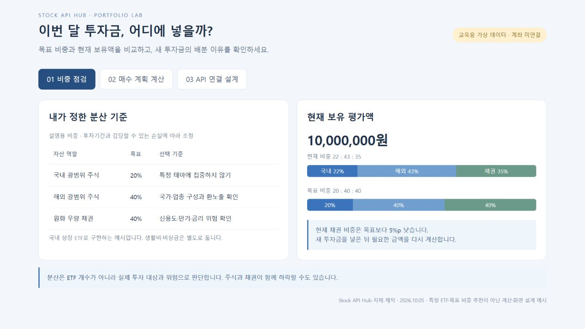
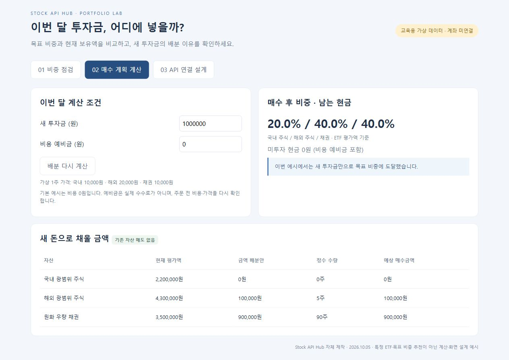
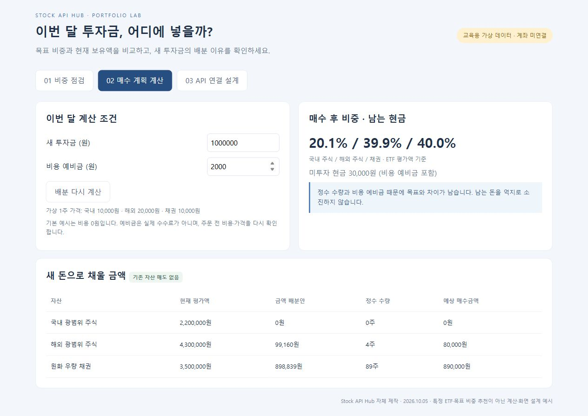
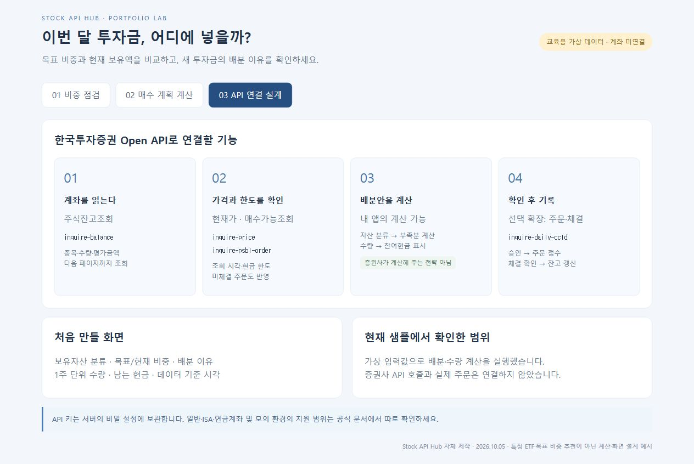

# ETF 포트폴리오 리밸런싱 데모

Stock API Hub 전략 인사이트 5번 글의 캡처 화면을 실행하는 자체 제작 교육용 데모입니다. 한국투자증권 공식 앱이 아닙니다.

## 실행

Code → Download ZIP으로 내려받아 압축을 풀고 `index.html`을 브라우저에서 여세요. 설치나 API 키가 필요하지 않습니다.

- 비중 점검: 가상 평가액 1,000만 원, 현재 22:43:35와 목표 20:40:40 비교
- 매수 계획: 새 투자금과 비용 예비금을 입력해 부족액 비례 배분 및 정수 수량 계산
- API 연결 설계: 향후 연동 흐름을 설명하는 화면 (API 호출 없음)

## 확인할 예시

| 새 투자금 | 비용 예비금 | 국내/해외/채권 수량 | 남는 현금 |
|---|---|---|---|
| 1,000,000원 | 0원 | 0 / 5 / 90주 | 0원 |
| 1,000,000원 | 2,000원 | 0 / 4 / 89주 | 30,000원 |
| 0원 | 0원 | 0 / 0 / 0주 | 0원 |

`node check.cjs`로 위 계산 및 현금 한도 검증을 실행합니다.

목표 비중, 평가액, 가격은 고정된 가상 값입니다. 기존 자산을 매도하지 않으며, 정수 수량 때문에 목표 비중에 정확히 도달하지 않을 수 있습니다. 표시 비중은 현금을 제외한 ETF 평가액 기준입니다. 비용 예비금은 실제 수수료 계산이 아닙니다. 계좌 연결·주문·정기 실행·수익률 백테스트는 구현하지 않았습니다.

## 게시글에 사용한 실행 화면

[관련 게시글](https://stockapihub.com/community.html#insights/post/d153a7af-8f47-5965-bb6d-b75e4ebf2d70)

[한국투자증권 API 참고 소스](https://github.com/koreainvestment/open-trading-api)는 향후 API 연결을 위한 자료이며 이 데모 화면의 소스가 아닙니다.
